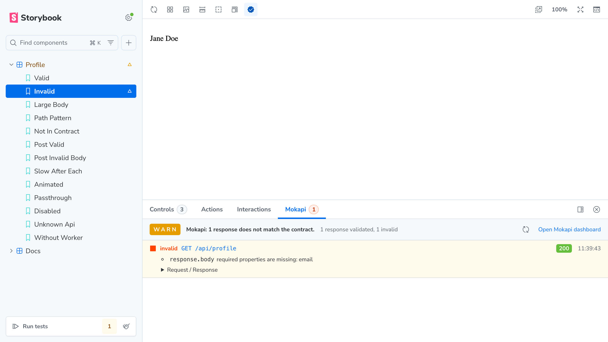

# mokapi-storybook-addon

Check your Storybook mocks against your OpenAPI contract with
[Mokapi](https://mokapi.io).

Your stories already use [MSW](https://mswjs.io) handlers to mock API
responses. This addon sends each mocked request and response to Mokapi, which
validates the pair against your OpenAPI contract. You keep your MSW setup and see
in the story when a mock drifts from the API.

- **One toolbar toggle:** an icon button that turns validation on or off. Off sends nothing.
- **Your MSW setup stays yours:** nothing Mokapi-specific goes into `.storybook/preview.ts` or into your stories.
- **Panel with badge:** every validated response shows as valid, invalid or not in the contract, with Mokapi's error messages. The tab shows how many are invalid.
- **No change for the component:** it gets the MSW response unchanged and without delay.



## How it works

```
  Story renders, component calls fetch('/api/profile')
                      │
                      ▼
        MSW service worker answers with your handler
                      │ response:mocked event
                      ▼
          addon copies the request and response
                      │ POST <dashboardUrl>/api/services/http/validate
                      ▼
        Mokapi finds the operation in your OpenAPI
        contract and checks request and response
                      │
                      ▼
        Mokapi panel in Storybook: valid / invalid /
        not in contract, badge counts the invalid ones
```

The addon registers a `beforeEach` hook in its own preview annotations. Storybook
runs it after all loaders, so the MSW worker that your loader put in
`context.msw` already exists. The hook listens to the worker's `response:mocked`
event. It copies the request and the response, sends the copy to Mokapi and
shows the result in the panel. The addon never starts Mokapi or MSW and imports
nothing from `msw`.

Only responses from your handlers are validated. Requests that you pass through
with `passthrough()` or that no handler matches are not sent.

## Requirements

- [Mokapi](https://mokapi.io/docs/get-started/installation) 0.58.0 or newer
- Storybook 10.6.4 or newer with the Vite builder and CSF3 stories
- MSW 2.15.0 or newer
- React 18 or newer (used for the addon panel only)
- Node.js 22.12.0 or newer

## Quick start

This example assumes that your Storybook already uses MSW with
`msw-storybook-addon`.

### 1. Install

```sh
npm install --save-dev mokapi-storybook-addon
```

Install Mokapi as well if you don't have it yet, for example, with
`npm install --save-dev go-mokapi`.

### 2. Register the addon

```ts
// .storybook/main.ts
export default {
  framework: '@storybook/react-vite',
  addons: [
    {
      name: 'mokapi-storybook-addon',
      options: {
        dashboardUrl: 'http://localhost:8080', // default
        defaultValidation: false,              // default
      },
    },
  ],
};
```

Both options are optional. Without options, the addon uses the Mokapi dashboard
at `http://localhost:8080` and starts with validation off.

### 3. Keep your MSW setup

Your `.storybook/preview.ts` needs no addon code:

```ts
// .storybook/preview.ts
import { setupWorker } from 'msw/browser';
import { mswLoader } from 'msw-storybook-addon/csf3';

export default {
  loaders: [
    mswLoader(async () => {
      const worker = setupWorker();
      await worker.start({ onUnhandledRequest: 'bypass', quiet: true });
      return worker;
    }),
  ],
};
```

`msw-storybook-addon` is optional. If you use your own loader, it must set
`context.msw` to the worker (or server) that answers your requests. The addon
reads the worker from there.

### 4. Write stories

Stories stay plain MSW:

```ts
// src/Profile.stories.ts
import { http, HttpResponse } from 'msw';
import { Profile } from './Profile';

export default { title: 'Profile', component: Profile };

export const Valid = {
  parameters: {
    msw: {
      handlers: [
        http.get('/api/profile', () =>
          HttpResponse.json({ name: 'Jane Doe', email: 'jane@example.com' }),
        ),
      ],
    },
  },
};
```

### 5. Start Mokapi and Storybook

Start Mokapi with your OpenAPI contract, then Storybook:

```sh
npx mokapi ./openapi.json
npx storybook dev
```

Open a story, click the **Validate with Mokapi** icon button in the toolbar to
switch validation on and open the **Mokapi** panel.

## Toggle

The toolbar has one icon button, **Validate with Mokapi**. One click switches
validation on or off. The button is highlighted while validation is on, and its
tooltip shows the state:

- `Mokapi validation is on. Click to turn off.`
- `Mokapi validation is off. Click to turn on.`

The button sets the global `mokapiValidation` to `on` or `off`. The initial value
comes from `defaultValidation`. With `defaultValidation: true`, the button starts
highlighted. Assistive technology reads the button as a switch named "Validate
with Mokapi" that is checked while validation is on.

The button only appears in story view, not on Docs pages, because the story
remount below only works there.

Switching does not reload the preview. The addon remounts the current story, so
a component that fetches on mount requests its data again. When you switch
validation on, those requests are validated right away, and the panel list
starts empty.

## Choosing the API

Mokapi can serve several APIs. Without `parameters.mokapi.api`, Mokapi searches
all of them for an operation that matches the request's method and path.

If more than one API matches, Mokapi can't choose. The addon then shows the
request as **not in contract**, and the entry contains Mokapi's message with the
names of the matching APIs. To fix it, set the API's `info.title`:

```ts
// .storybook/preview.ts, a story file or a single story
export default {
  parameters: {
    mokapi: { api: 'Profile API' },
  },
};
```

`parameters.mokapi` is inherited from preview, component and story, as other
Storybook parameters. A story can overwrite the value of the project.

If `api` names an API that Mokapi doesn't know, the panel shows a notice with
Mokapi's message, see [Errors](#errors).

## Disabling a story

A story that has no contract, for example a mock for a third-party API, can opt
out:

```ts
export const ThirdParty = {
  parameters: {
    mokapi: { disable: true },
    msw: { handlers: [/* ... */] },
  },
};
```

The addon sends nothing to Mokapi for this story, also when the toggle is on.

## Panel and badge

The **Mokapi** panel shows the responses of the selected story since its last
render. Switching to another story or rendering the story again clears the
list. Each entry shows the method, URL, HTTP status of the response and time,
and one of these results:

| Result                 | Meaning                                                                          |
|------------------------|----------------------------------------------------------------------------------|
| valid                  | Request and response fit the contract                                            |
| invalid                | The contract is violated. The entry lists each error with its `location` (for example `response.body`) and message |
| not in contract        | Mokapi found no operation for the request, or several APIs match. The entry shows Mokapi's message |
| Mokapi not reachable   | The request to Mokapi failed. The entry shows the URL and a hint to `dashboardUrl` |

The tab title shows a badge with the number of invalid responses. Responses that
are not in the contract and not-reachable entries are not counted.

Notices appear at the top of the panel when the addon can't validate:

- Mokapi is not reachable.
- The Mokapi at `dashboardUrl` has no validation endpoint and must be updated to 0.58.0.
- Mokapi reports a configuration error, for example an unknown `api`.
- The MSW worker is missing from `context.msw`.

The exact texts are listed in [Errors](#errors). With validation off, the panel
shows a hint how to turn it on. The panel also links to the Mokapi dashboard.

## Docs pages

Use Storybook's Docs page with stories that are not inline:

```ts
// .storybook/preview.ts
export default {
  parameters: {
    docs: { story: { inline: false, iframeHeight: '300px' } },
  },
};
```

Each story then runs in its own iframe with its own MSW worker. Inline stories
share one worker, so the addon can't attribute their results to a story. See
[Limitations](#limitations).

The toolbar button is not shown on Docs pages. Switch validation on in story
view first, or set `defaultValidation: true`.

## Static builds and deployment

The browser calls Mokapi directly. The addon sets up no proxy, so `storybook dev`
and `storybook build` use the same `dashboardUrl`. It must be an address that the
browser of every viewer can reach, not only the machine that builds Storybook.

Mokapi answers the request with `Access-Control-Allow-Origin: *`, so no CORS
setup is needed.

A Storybook served over HTTPS can't call Mokapi on a plain `http://` address other
than `localhost`: browsers block this as mixed content. Chrome and Firefox allow
`http://localhost`, but Chrome may ask for permission to access the local network,
and other browsers may still block it. Put Mokapi behind an HTTPS reverse proxy
and use its address as `dashboardUrl`, or run Storybook over HTTP while you
validate.

Only expose the dashboard API to trusted users. Don't put credentials in
`dashboardUrl`, because the option is visible in the browser.

## API

### Addon options

Set in `.storybook/main.ts`. Restart Storybook after changing them.

| Option              | Type      | Default                   | Description                                         |
|---------------------|-----------|---------------------------|-----------------------------------------------------|
| `dashboardUrl`      | `string`  | `'http://localhost:8080'` | Mokapi dashboard URL, must be reachable from the browser. A trailing slash is removed |
| `defaultValidation` | `boolean` | `false`                   | Initial state of the toolbar toggle. `true` starts with validation on and the button highlighted |

### `parameters.mokapi`

| Field     | Type      | Description                                                                 |
|-----------|-----------|-----------------------------------------------------------------------------|
| `api`     | `string`  | OpenAPI `info.title` of the story's API. Optional, see [Choosing the API](#choosing-the-api) |
| `disable` | `boolean` | Sends nothing to Mokapi for this story                                      |

### Global `mokapiValidation`

| Value   | Description                                     |
|---------|-------------------------------------------------|
| `'on'`  | Validate the responses of the mocked requests   |
| `'off'` | Validate nothing (default)                      |

The toolbar button switches the global. You can set the initial value with
`defaultValidation`, or with the URL parameter `globals=mokapiValidation:on`.

### TypeScript

Type definitions are included. Importing `mokapi-storybook-addon` adds
`mokapi` to Storybook's `Parameters` type.

## Errors

Invalid options throw an error when Storybook starts:

- `Mokapi: dashboardUrl must be an HTTP(S) URL.`
- `Mokapi: defaultValidation must be true or false.`

The panel shows these notices. None of them stops the story, and none counts in
the badge:

| Notice | Cause and fix |
|--------|---------------|
| `Mokapi is not reachable at <url>. Check the dashboardUrl option and that Mokapi is running.` | The request failed. Start Mokapi or fix `dashboardUrl` |
| `Mokapi at <url> does not support /api/services/http/validate. Update Mokapi to 0.58.0.` | Your Mokapi is older than 0.58.0 |
| Mokapi's message, for example for an unknown API | `parameters.mokapi.api` names an API that Mokapi doesn't serve. Use the `info.title` of your contract |
| `Mokapi answered HTTP <status>: <message>` | Any other unexpected answer from Mokapi. Mokapi's message is added if it sent one |
| ``MSW worker not found: `context.msw` is missing. Use `mswLoader` or set `context.msw` in your loader.`` | The story has no MSW worker. Use `mswLoader` or set `context.msw` in your own loader |

The notice about a missing worker only appears while validation is on. With
validation off, a story without a worker runs without any message.

## Limitations

- Inline Docs stories share one MSW worker, so their results can't be attributed
  to a story. Use `inline: false`, see [Docs pages](#docs-pages).
- Only responses from MSW handlers are validated, not `passthrough()` or
  unhandled requests.
- If you switch validation on while the story is finishing its render (for example
  while its play function runs or Storybook waits for animations), a request can
  show up twice in the panel. Render the story again to get a clean list.
- The addon needs a worker (or server) with MSW's `events.on` in `context.msw`.
- Mokapi validates the request and response pair against the contract. It does
  not run your handlers.
- Storybook with Vite and CSF3 only. Webpack and CSF Next are not supported.
  Only React projects are tested.
- A Storybook served over HTTPS can't reach Mokapi on a plain `http://` address, see
  [Static builds and deployment](#static-builds-and-deployment).
- Requires Mokapi 0.58.0 or newer, see [Requirements](#requirements).

## License

[MIT](LICENSE)
