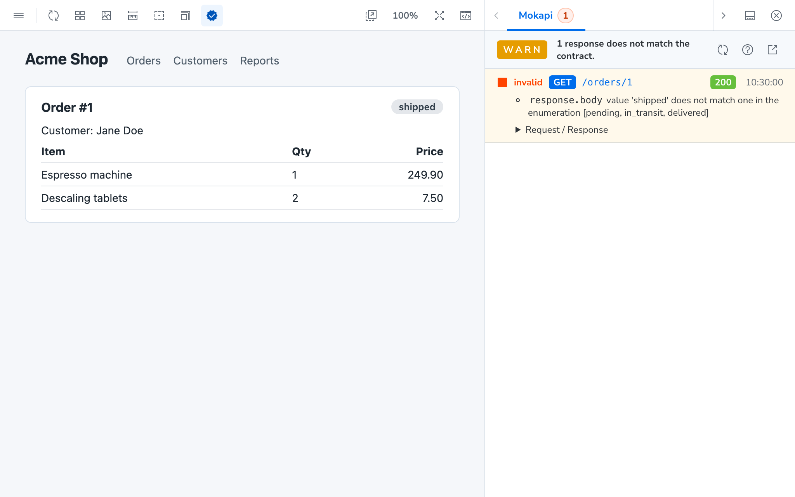

# mokapi-storybook-addon

Check your Storybook mocks against your OpenAPI contract with
[Mokapi](https://mokapi.io).

Your stories already use [MSW](https://mswjs.io) handlers to mock API
responses. This addon sends each mocked request and response to Mokapi, which
validates the pair against your OpenAPI contract. You keep your MSW setup and see
in the story when a mock drifts from the API.

- **One toolbar toggle:** an icon button that turns validation on or off. Off sends nothing.
- **Your MSW setup stays yours:** nothing Mokapi-specific goes into `.storybook/preview.ts` or into your stories.
- **Panel with badge:** every validated response shows as valid, invalid or not in the contract, with Mokapi's error messages. The tab shows how many are invalid.
- **Failing stories:** optionally, a story fails when its responses don't match the contract, so CI catches contract drift. In Storybook the story gets an error or warning icon in the sidebar.
- **No change for the component:** it gets the MSW response unchanged and without delay.



The full documentation is on [mokapi.io](https://mokapi.io/docs/integrations/storybook).

## Requirements

- [Mokapi](https://mokapi.io/docs/get-started/installation) 0.58.0 or newer (0.60.0 for [partial responses](https://mokapi.io/docs/integrations/storybook/usage#partial-responses))
- Storybook 10.6.7 or newer with the Vite builder and CSF3 stories
- MSW 2.15.0 or newer
- Node.js 22.12.0 or newer

## Quick start

This example assumes that your Storybook already uses MSW with
`msw-storybook-addon`.

### 1. Install

```sh
npm install --save-dev mokapi-storybook-addon
```

Install Mokapi as well if you don't have it yet, for example, with
`npm install --save-dev go-mokapi`.

### 2. Register the addon

```ts
// .storybook/main.ts
export default {
  framework: '@storybook/react-vite',
  addons: [
    {
      name: 'mokapi-storybook-addon',
      options: {
        dashboardUrl: 'http://localhost:8080', // default
        defaultValidation: false,              // default
      },
    },
  ],
};
```

Both options are optional. Without options, the addon uses the Mokapi dashboard
at `http://localhost:8080` and starts with validation off.

### 3. Keep your MSW setup

Your `.storybook/preview.ts` needs no addon code:

```ts
// .storybook/preview.ts
import { setupWorker } from 'msw/browser';
import { mswLoader } from 'msw-storybook-addon/csf3';

export default {
  loaders: [
    mswLoader(async () => {
      const worker = setupWorker();
      await worker.start({ onUnhandledRequest: 'bypass', quiet: true });
      return worker;
    }),
  ],
};
```

`msw-storybook-addon` is optional. If you use your own loader, it must set
`context.msw` to the worker (or server) that answers your requests. The addon
reads the worker from there.

### 4. Write stories

Stories stay plain MSW:

```ts
// src/Profile.stories.ts
import { http, HttpResponse } from 'msw';
import { Profile } from './Profile';

export default { title: 'Profile', component: Profile };

export const Valid = {
  parameters: {
    msw: {
      handlers: [
        http.get('/api/profile', () =>
          HttpResponse.json({ name: 'Jane Doe', email: 'jane@example.com' }),
        ),
      ],
    },
  },
};
```

### 5. Start Mokapi and Storybook

Start Mokapi with your OpenAPI contract, then Storybook:

```sh
npx mokapi ./openapi.json
npx storybook dev
```

Open a story, click the **Validate with Mokapi** icon button in the toolbar to
switch validation on and open the **Mokapi** panel.

## Configuration

### Addon options

Set in `.storybook/main.ts`. Restart Storybook after changing them.

| Option              | Type      | Default                   | Description                                         |
|---------------------|-----------|---------------------------|-----------------------------------------------------|
| `dashboardUrl`      | `string`  | `'http://localhost:8080'` | Mokapi dashboard URL, must be reachable from the browser. A trailing slash is removed |
| `defaultValidation` | `boolean` | `false`                   | Initial state of the toolbar toggle. `true` starts with validation on and the button highlighted |
| `defaultTest`       | `'error' \| 'warning' \| 'off'` | `'warning'` | Test mode of all stories, see [Failing stories](https://mokapi.io/docs/integrations/storybook/failing-stories) |
| `defaultPartial`    | `boolean` | `false`                   | Validate the responses of all stories as partial responses, see [Partial responses](https://mokapi.io/docs/integrations/storybook/usage#partial-responses). Needs Mokapi 0.60.0 |
| `defaultTimeout`    | `number`  | `4000`                    | Milliseconds a story waits for its responses and their validation, quiet window included. Must be a finite number greater than 0, see [Wait limit](https://mokapi.io/docs/integrations/storybook/failing-stories#wait-limit) |

### `parameters.mokapi`

| Field     | Type      | Description                                                                 |
|-----------|-----------|-----------------------------------------------------------------------------|
| `api`     | `string`  | OpenAPI `info.title` of the story's API. Optional, see [Choosing the API](https://mokapi.io/docs/integrations/storybook/usage#choosing-the-api) |
| `disable` | `boolean` | Sends nothing to Mokapi for this story                                      |
| `test`    | `'error' \| 'warning' \| 'off'` | Overrides `defaultTest` for this story, see [Failing stories](https://mokapi.io/docs/integrations/storybook/failing-stories) |
| `partial` | `boolean` | Overrides `defaultPartial` for this story, see [Partial responses](https://mokapi.io/docs/integrations/storybook/usage#partial-responses) |
| `timeout` | `number`  | Overrides `defaultTimeout` for this story, in milliseconds, see [Wait limit](https://mokapi.io/docs/integrations/storybook/failing-stories#wait-limit) |

### Global `mokapiValidation`

| Value   | Description                                     |
|---------|-------------------------------------------------|
| `'on'`  | Validate the responses of the mocked requests   |
| `'off'` | Validate nothing (default)                      |

The toolbar button switches the global of the current preview only. You can set
the initial value with `defaultValidation`, with the URL parameter
`globals=mokapiValidation:on`, or for component tests with
`storybookTest({ initialGlobals: { mokapiValidation: 'on' } })`, see
[Vitest](https://mokapi.io/docs/integrations/storybook/failing-stories#vitest).

## Documentation

- [Overview](https://mokapi.io/docs/integrations/storybook): how the addon works, requirements and quick start
- [Usage](https://mokapi.io/docs/integrations/storybook/usage): toggle, choosing the API, partial responses, panel and badge, Docs pages
- [Failing Stories](https://mokapi.io/docs/integrations/storybook/failing-stories): test modes, wait limit, sidebar status, Vitest and Playwright
- [Reference](https://mokapi.io/docs/integrations/storybook/reference): options, parameters, errors, limitations, static builds and deployment

## License

[MIT](LICENSE)
